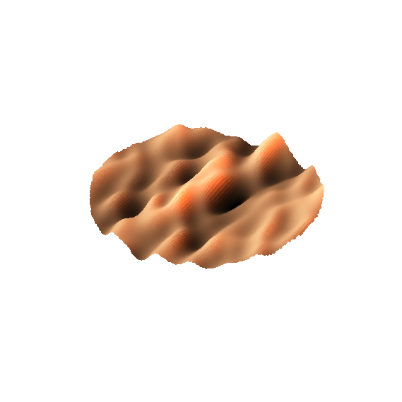
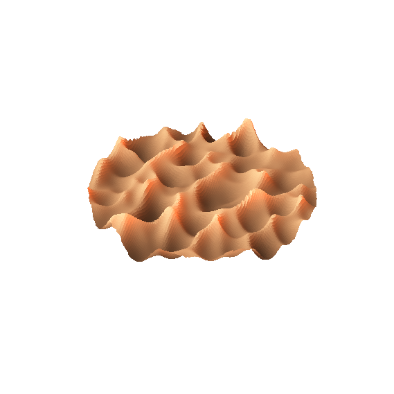
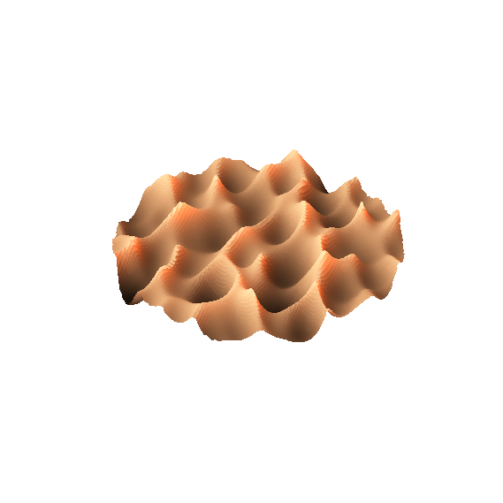
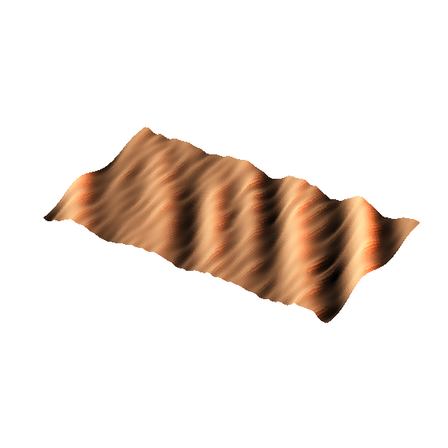

# choppy-water

[](https://github.com/AstroJoeBretz/choppy-water/actions/workflows/ci.yml)

Generate a choppy-water surface and export it as a watertight STL for CNC milling in wood.
The piece is a **disc** or a **rectangle** with a flat bottom and a choppy-water top, and every
model and milling parameter lives in one TOML config file.

| `calm` | `choppy` (default look) | `choppy_gerstner` | `plaque` |
|:---:|:---:|:---:|:---:|
|  |  |  |  |
|  |  |  |  |

*Previews written by the tool: top-down and an angled 3D view (true proportions). The
configs behind them are the built-in examples; list them with `choppy-water --list-examples`.*

## Features

- Disc (diameter) or rectangle (width x length) outlines; inches or millimetres.
- Realistic random seas (FFT wave spectrum) or simple Gerstner waves, with a choppiness control
  for sharp crests. Same seed, same surface.
- Optional second wave layer: calm swells with sharp chop riding on top (`[water.chop]`).
- Watertight, correctly oriented binary STL with a flat bottom, ready for CAM.
- Knows about the cutter: valleys narrower than your ball nose are filled in the model so it
  matches what you can actually cut, and a report gives slope, scallop height, time and layers.

## How it works

1. **Waves.** A random sea is built from a wave spectrum described in carver terms: dominant,
   shortest and longest wavelength, how scattered the directions are, and the total relief.
   The default method (`fft`) is Tessendorf-style ocean synthesis: random numbers shaped by the
   spectrum are inverse-FFT'd into a height field. `gerstner` instead sums 64 Gerstner waves.
2. **Choppiness.** Surface points are pushed horizontally toward the crests, which sharpens
   them. The result is then resampled onto a regular grid so the surface has exactly one height
   at each point, which is what a 3-axis mill needs. If the crests would curl over, the tool
   reports it.
3. **Layers.** An optional `[water.chop]` layer is generated separately and added to the first,
   so short, sharp chop can ride on long calm swells.
4. **Cutter reach.** A ball-nose cutter cannot enter a valley narrower than itself. The tool
   computes the surface the cutter will actually leave and, by default, puts that in the STL.
5. **Solid.** The surface is joined to vertical walls and a flat bottom into a closed mesh,
   checked to be watertight before it is written.

The details, formulas and code layout are in [docs/ARCHITECTURE.md](docs/ARCHITECTURE.md).

## Install

Requires Python 3.11+. Not yet on PyPI, so install from a clone:

```bash
git clone https://github.com/AstroJoeBretz/choppy-water.git
cd choppy-water
python -m venv .venv
pip install -e ".[preview]"   # add ,dev for the test tools
```

Then activate the environment (or call `.venv\Scripts\choppy-water` directly):

```powershell
.venv\Scripts\Activate.ps1      # Windows PowerShell
```
```bash
source .venv/bin/activate       # macOS / Linux
```

Without matplotlib (`[preview]`) everything works except the PNG previews, which are skipped
with a warning.

## Quick start

```bash
choppy-water                                  # defaults: 3 in disc cut from 1 in stock
choppy-water --list-examples                  # the built-in examples
choppy-water --example plaque                 # run one
choppy-water --config my.toml                 # run your own config
choppy-water --seed 7 --set water.choppiness=0.5   # tweak from the command line
choppy-water --write-config my.toml           # commented defaults to start from
choppy-water --config my.toml --check         # validate without generating
```

A run takes about 15 to 30 seconds. Each run writes a folder named after the config
(`output/plaque/` for `--example plaque`, `output/choppy_water/` with no config):

| File | What it is |
|---|---|
| `plaque.stl` | The model for your CAM software. Millimetres, flat bottom at z = 0. |
| `plaque.png`, `plaque_3d.png` | Top-down and angled previews. |
| `plaque_milling.txt` | Plain-text milling report (sample below). |
| `plaque.json` | Resolved settings and measurements. `choppy-water --config plaque.json` reproduces the run exactly. |

```
Tool
  Ball nose diameter:     0.125 in
  Valleys too fine to cut: 0.0% of the part (up to 0.000 in deep, filled in the STL)
  Steepest slope:         35 deg (0.0% of the part over 70 deg)

Finishing pass (raster along X)
  Stepover:               0.013 in (10% of the tool)
  Scallop height (flat):  0.0003 in
  Estimated time:         28 min at 60 in/min
```

## Configuration

Copy the defaults with `--write-config` and list only what you change. The two outlines:

```toml
[part]
shape    = "disc"   # diameter = 3.0 by default
diameter = 3.0
```

```toml
[part]
shape  = "rect"
width  = 4.0        # X
length = 3.0        # Y
```

Defaults: 3 in disc, 1 in stock, 1/8 in ball nose. Every key is described in
[docs/CONFIG.md](docs/CONFIG.md). Common adjustments:

| To get... | Change |
|---|---|
| A different sea with the same character | `water.seed` |
| Sharper crests, broader troughs | raise `water.choppiness` (around 1 is cusped; above 1 folds) |
| Longer, calmer swells | raise `water.wavelength_dominant`, `wavelength_max`; lower `choppiness` |
| Tidier parallel waves | lower `water.directional_spread_deg` |
| Taller waves | raise `water.relief` (and `part.max_thickness` to make room) |
| Chop on top of swell | add a `[water.chop]` table (see the `plaque` example) |
| A rectangle instead of a disc | `part.shape = "rect"`, `width`, `length` |
| Fewer fine details the cutter can't cut | raise `water.wavelength_min`, or use a smaller `tool_diameter` |

## Milling

With `milling.enforce_tool_limits = true` (the default) the STL contains the surface the cutter
can actually leave, so what you see is what you can cut. See
[docs/MILLING.md](docs/MILLING.md) for a suggested CAM workflow and how to read the report.

## Limitations

- **Heightfield only.** Single-valued surfaces for 3-axis milling: no overhangs or undercuts, and
  curling wave crests are flattened (the tool tells you how much).
- **No G-code or toolpaths.** The output is a model; your CAM software makes the toolpaths.
- **Time estimates are rough.** They cover the finishing pass only, not roughing, rapids or the
  profile cut.
- **Ball-nose finishing only** (`milling.tool_type = "ball"`).
- **STL has no units.** It is written in millimetres by default; check your CAM import units.
- **Tool-reach numbers need a fine grid** (about ten cells across the cutter). The tool warns
  when the grid is too coarse.
- `milling.plunge_rate` and `milling.spindle_rpm` are stored for reference but not used in any
  calculation yet.
- Not tested against specific CAM packages or machines: do a test cut on scrap.

## Development

```bash
pip install -e ".[dev]"
pytest
ruff check .
python scripts/make_gallery.py   # regenerate docs/images from the built-in examples
```

Changes are listed in [CHANGELOG.md](CHANGELOG.md).

## License

MIT. See [LICENSE](LICENSE).
