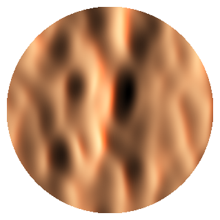
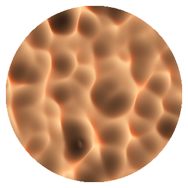
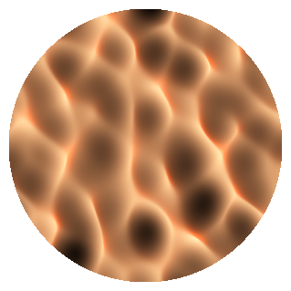
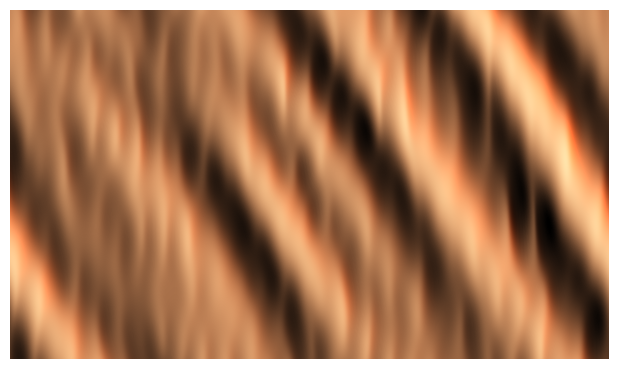

# choppy-water

Generate a choppy-water surface and export it as a watertight STL for CNC milling in wood.
The piece is a **disc** or a **rectangle** with a flat bottom and a choppy-water top, and every
model and milling parameter lives in one TOML config file.

| Calm | Choppy (default) | Choppy Gerstner | Swell and chop plaque |
|:---:|:---:|:---:|:---:|
|  |  |  |  |

*Shaded previews written by the tool. Presets live in [examples/](examples/).*

## Features

- Disc (diameter) or rectangle (width x length) outlines; inches or millimetres.
- Realistic random seas (FFT wave spectrum) or simple Gerstner waves, with a choppiness control
  for sharp crests. Same seed, same surface.
- Optional second wave layer: calm swells with sharp chop riding on top (`[water.chop]`).
- Watertight, correctly oriented binary STL with a flat bottom, ready for CAM.
- Knows about the cutter: valleys narrower than your ball nose are filled in the model so it
  matches what you can actually cut, and a report gives slope, scallop height, time and layers.

## Install

Requires Python 3.11+. Not yet on PyPI, so install from a clone:

```bash
git clone <this repository>
cd choppy-water
python -m venv .venv
.venv\Scripts\activate        # Windows; use `source .venv/bin/activate` elsewhere
pip install -e ".[preview]"   # add ,dev for the test tools
```

## Quick start

```bash
choppy-water                                       # defaults: 3 in disc from 1 in stock
choppy-water --config examples/choppy_gerstner.toml  # a preset
choppy-water --seed 7 --set water.choppiness=0.5   # tweak from the command line
choppy-water --write-config my.toml                # commented defaults to edit
choppy-water --config my.toml --check              # validate without generating
```

A run takes roughly 15 seconds and writes a folder named after the config file, for example
`output/choppy_gerstner/` for `examples/choppy_gerstner.toml` (`output/choppy_water/` with no config):
`choppy_gerstner.stl`, a `.png` preview, a `_milling.txt` report and a `.json` run record.

## Configuration

Copy the defaults with `--write-config` and list only what you change. The two outlines:

```toml
[part]
shape    = "disc"   # diameter = 3.0 by default
diameter = 3.0
```

```toml
[part]
shape  = "rect"
width  = 4.0        # X
length = 3.0        # Y
```

Defaults: 3 in disc, 1 in stock, 1/8 in ball nose. Every key is described in
[docs/CONFIG.md](docs/CONFIG.md).

## Milling

A ball-nose cutter cannot enter a valley narrower than itself. With
`milling.enforce_tool_limits = true` (the default) the STL contains the surface the cutter can
actually leave, so what you see is what you can cut. See [docs/MILLING.md](docs/MILLING.md) for a
suggested CAM workflow and how to read the report. Estimates cover the finishing pass only.

## Development

```bash
pip install -e ".[dev]"
pytest
ruff check .
python scripts/make_gallery.py   # regenerate docs/images from examples/
```

Project layout and the build plan are in [docs/PLAN.md](docs/PLAN.md); changes are in
[CHANGELOG.md](CHANGELOG.md).

## License

MIT. See [LICENSE](LICENSE).
